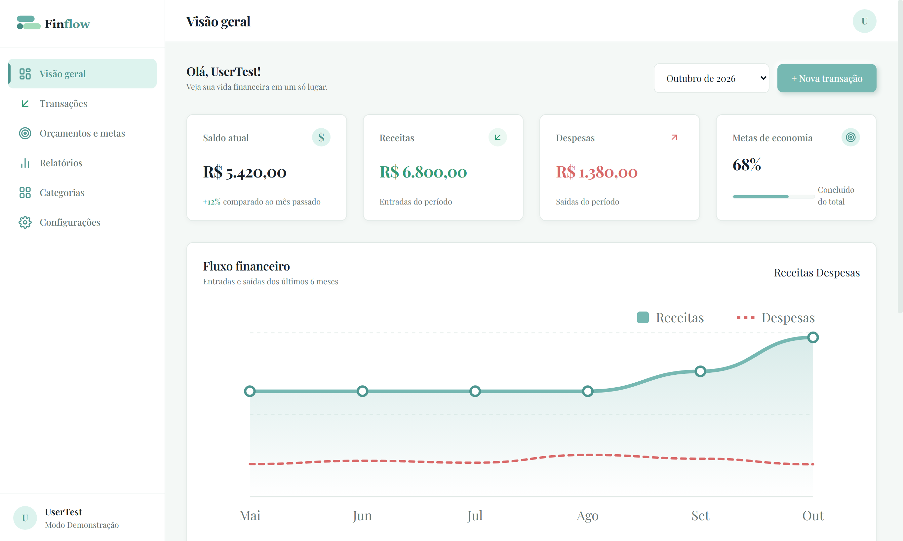
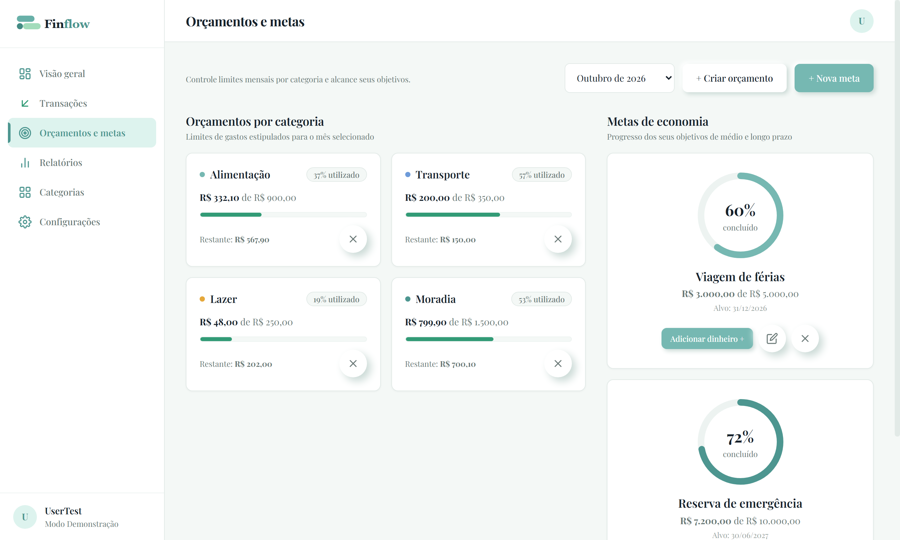
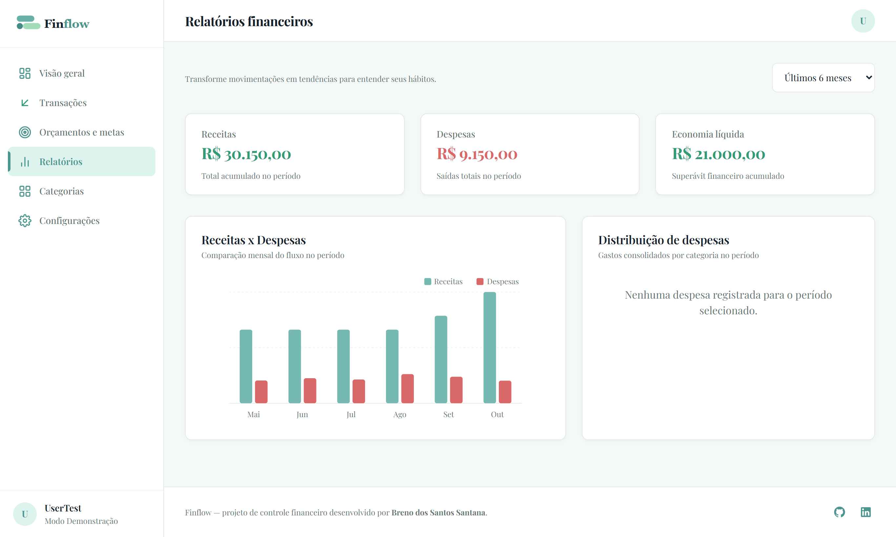
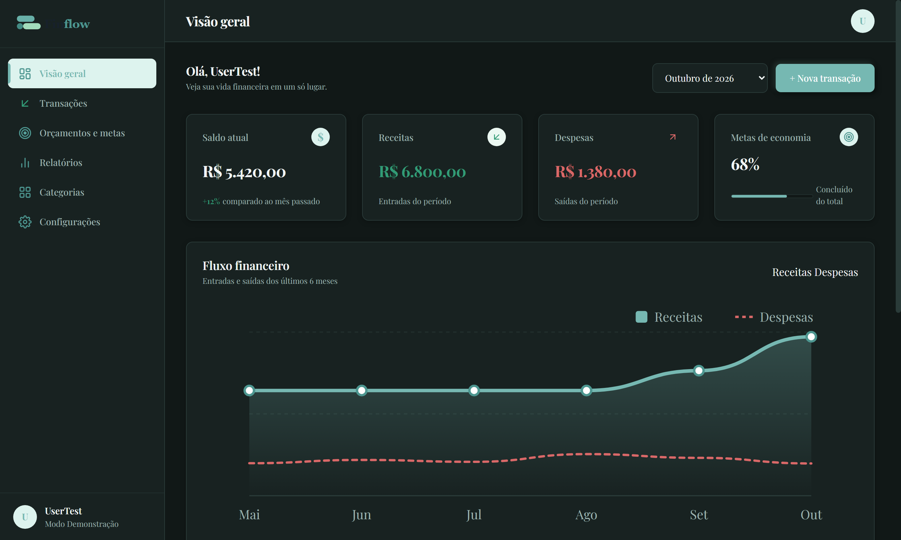
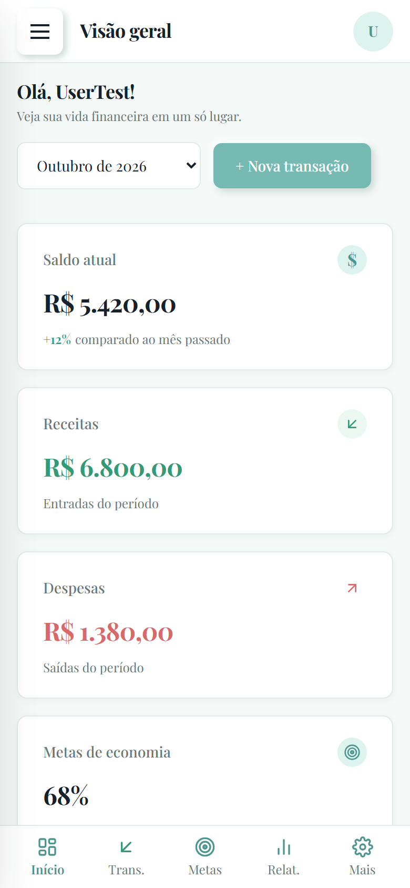

# Finflow — Seu Controle Financeiro

> Uma aplicação web moderna, leve e intuitiva de controle financeiro pessoal, desenvolvida com foco em engenharia de software front-end, design system consistente, acessibilidade e documentação técnica completa.

**Autor:** Breno dos Santos Santana  
**Objetivo:** Projeto de portfólio para demonstração prática de competências em desenvolvimento Front-end para oportunidades de estágio e júnior.  
**Demonstração Online:** Compatível com GitHub Pages (100% estático, sem necessidade de servidor backend).
**link no github pages: https://breno2274.github.io/FinFlow/
---

## Demonstração Visual da Aplicação

<div align="center">
  
  <p><i>Painel executivo com métricas em tempo real, fluxo financeiro mensal em gráfico SVG suave e navegação rápida.</i></p>
</div>

### Galeria de Recursos e Experiência do Usuário

<div align="center">
  <br />
  <h4>Orçamentos por Categoria e Metas de Economia</h4>
  
  <p><i>Acompanhamento visual de tetos de gastos e metas com anéis de progresso circulares.</i></p>

  <br />
  <h4>Relatórios Analíticos e Tendências</h4>
  
  <p><i>Gráficos de barras mensais e consolidado financeiro desenvolvidos puramente com SVG vetorial.</i></p>

  <br />
  <h4>Tema Escuro (Dark Mode) e Adaptação Fluida para Celulares</h4>
  <div style="display: flex; justify-content: center; gap: 16px; flex-wrap: wrap;">
    
    
  </div>
  <p><i>Design responsivo com gaveta lateral retrátil no celular e alternância instantânea entre modo claro e escuro.</i></p>
</div>

---

## 1. Visão Geral e Proposta de Valor

O **Finflow** nasceu da necessidade de transformar a complexidade da gestão financeira diária em uma experiência visual acolhedora, clara e rápida. 

O projeto adota uma identidade visual original em tons de **verde-água (`#76B8B2`)**, **menta suave (`#DDF3EE`)** e **verde escuro (`#4D9690`)**, fundamentada em cartões brancos com bordas suaves, tipografia contemporânea e gráficos informativos nativos em SVG.

---

## 2. Funcionalidades Implementadas

- **Landing Page Institucional (Tela 01):** Apresentação do produto, prévia visual vetorial do painel, cartões de benefícios e chamada para ação com acesso instantâneo ao aplicativo.
- **Painel Executivo / Dashboard (Tela 03):** 
  - Cartões métricos com cálculo em tempo real de Saldo Atual, Receitas, Despesas e Metas ativas.
  - Gráfico nativo em SVG de fluxo financeiro com curvas suaves de receitas e despesas nos últimos 6 meses.
  - Listagem de transações recentes com data relativa ("Hoje", "Ontem", "12 out.") e valores formatados em moeda brasileira (`R$`).
  - Seletor dinâmico de período e botão de acesso rápido para novo lançamento.
- **Registro de Transações (Tela 05):** Modal acessível com alternância entre Receita e Despesa, validação em tempo real de campos obrigatórios, seleção dinâmica de categorias e campo de notas contextuais.
- **Lista Completa de Transações (Tela 04):**
  - Busca por texto em tempo real (descrição e nome da categoria).
  - Filtros multifatoriais por período (mês), tipo (receitas/despesas) e categoria.
  - Tabela com ações de edição e exclusão com diálogo de confirmação.
  - Paginação de dados e adaptação para cartões em celulares.
  - Exportação instantânea de extrato financeiro para planilhas em formato `.csv`.
- **Orçamentos e Metas (Tela 06):**
  - Definição e edição de tetos de gastos mensais por categoria com barras de utilização e alertas automáticos de atenção (>=80%) e limite excedido (>100%).
  - Metas de economia com anéis circulares percentuais (`goal-ring`), cálculo de valor restante e modal para registrar novos aportes e editar objetivos.
- **Relatórios Analíticos (Tela 07):** Gráfico comparativo de barras mensal em SVG (Receitas vs Despesas) e distribuição percentual proporcional de despesas por categoria.
- **Gestão de Categorias (Tela 08):** Cadastro, edição, escolha de paleta de cores e proteção de integridade referencial: impede a exclusão de categorias que possuem lançamentos ativos e oferece fluxo assistido de reclassificação.
- **Configurações e Gestão de Backup (Tela 09):** Preferências visuais (nome, moeda, chave toggle de tema claro/escuro), exportação de backup completo em `.json`, importação com validação de esquema, restauração de dados demo e limpeza total.
- **Login e Cadastro Demonstrativo (Tela 02):** Interface elegante com extração inteligente de nome pelo e-mail e aviso sobre o modo demonstração com LocalStorage.
- **Responsividade e Estados de Interface (Tela 10):** Menu lateral em gaveta retrátil (*off-canvas drawer*), barra de atalhos inferior em telas móveis (<768px), sistema de toasts acessíveis e ilustrações em estados vazios.

---

## 3. Tecnologias Utilizadas

- **React 18:** Componentização modular, reatividade declarativa de estado e eliminação de manipulações manuais de nós do navegador.
- **TypeScript (Modo Estrito):** Tipagem estática de ponta a ponta para transações, categorias, orçamentos, metas e preferências, prevenindo falhas de execução.
- **Vite:** Ferramenta de build moderna de inicialização instantânea e compilação otimizada para produção.
- **HTML5 Semântico:** Estruturação orientada a acessibilidade (`<header>`, `<nav>`, `<main>`, `<aside>`, `<footer>`, `<dialog>`, `<table>`).
- **CSS3 Puro com Tokens de Design e Sistema Neumórfico:** Centralização de cores, tipografia, espaçamentos, relevo com sombras duplas e efeitos de interação tátil em `src/css/tokens.css`.
- **Recursos Gráficos Vetoriais (SVG):** Logotipo, ilustrações de hero, estados vazios e ícones desenvolvidos internamente em SVG.
- **LocalStorage API:** Persistência de dados segura com versionamento de esquema (`2.0.0`) e eventos customizados para reatividade.

---

## 4. Estrutura de Pastas do Projeto

```text
finflow/
├── index.html                   # Casca leve de entrada da aplicação React (~25 linhas)
├── package.json                 # Dependências do projeto (React, TypeScript, Vite)
├── tsconfig.json                # Configurações do compilador TypeScript em modo estrito
├── vite.config.ts               # Configuração do Vite com caminhos relativos para GitHub Pages
├── README.md                    # Apresentação, telas e documentação geral do projeto
├── guide.md                     # Diretrizes permanentes de engenharia e sincronização
│
├── public/                      # Recursos visuais estáticos entregues pelo Vite
│   └── img/                     # Logotipos, símbolos e ícones SVG originais
│
├── src/
│   ├── main.tsx                 # Ponto de entrada do React e importação dos estilos CSS
│   ├── App.tsx                  # Roteador SPA baseado em Hash (#/) e Casca Principal
│   │
│   ├── types/                   # Modelos e contratos tipados (Transacao, Categoria, Meta, Orcamento)
│   │   └── index.ts
│   │
│   ├── css/                     # Sistema de design modular em Vanilla CSS (100% preservado)
│   │   ├── tokens.css           # Variáveis de cor, tipografia e espaçamento
│   │   ├── reset.css            # Normalização de estilo entre navegadores
│   │   ├── base.css             # Estilos fundamentais e acessibilidade (:focus-visible)
│   │   ├── layout.css           # Estrutura de casca (app-shell, sidebar e topbar)
│   │   ├── components.css       # Botões, cartões, formulários, modais, toasts e badges
│   │   ├── pages.css            # Estilos específicos de cada tela
│   │   └── responsive.css       # Regras para tablets e celulares (drawer e mobile-nav)
│   │
│   ├── services/                # Camada de regras de negócio e persistência no LocalStorage
│   │   ├── storage.ts           # Gestão do LocalStorage, dados demo, migração e backup JSON
│   │   ├── transactionService.ts# Lógica de negócio de transações, filtros, totais e tendências
│   │   ├── budgetService.ts     # Acompanhamento de limites de gastos mensais e alertas
│   │   ├── goalService.ts       # Metas de economia e cálculo de aportes
│   │   ├── categoryService.ts   # Categorias e proteção de integridade referencial
│   │   └── reportService.ts     # Agregações analíticas mensais e distribuição de gastos
│   │
│   ├── utils/                   # Utilitários puros
│   │   ├── format.ts            # Formatação em Real brasileiro (R$), porcentagens e moedas
│   │   ├── dates.ts             # Manipulação de datas, meses retroativos e datas relativas
│   │   └── csv.ts               # Exportação de extrato formatado para planilhas Excel/CSV
│   │
│   ├── hooks/                   # Custom Hooks do React
│   │   └── useFinflowData.ts    # Reatividade automática perante mudanças no LocalStorage
│   │
│   ├── components/              # Componentes React modulares e reutilizáveis
│   │   ├── layout/              # Sidebar lateral, Header superior e MobileNav inferior
│   │   ├── common/              # Modal acessível, Toast e EmptyState
│   │   ├── charts/              # Gráficos vetoriais SVG de fluxo, barras e anéis circulares
│   │   └── modals/              # Modais de formulário (transação, orçamento, meta, categoria)
│   │
│   └── pages/                   # Componentes dedicados para cada tela da aplicação
│       ├── LandingPage.tsx      # Página inicial institucional pública
│       ├── AboutPage.tsx        # Página sobre o projeto e tecnologias
│       ├── LoginPage.tsx        # Tela de acesso em modo demonstração
│       ├── DashboardPage.tsx    # Painel geral com cartões de saldo e fluxo financeiro
│       ├── TransactionsPage.tsx # Gestão de receitas e despesas com busca e filtros
│       ├── BudgetsPage.tsx      # Orçamentos por categoria e metas de economia
│       ├── ReportsPage.tsx      # Relatórios analíticos e tendências de gastos
│       ├── CategoriesPage.tsx   # Gestão de categorias com controle de integridade
│       └── SettingsPage.tsx     # Preferências, alternância de tema e backups
│
└── docs/                        # Documentação técnica de apoio
    └── screenshots/             # Capturas de tela para apresentação visual
```

---

## 5. Como Executar Localmente

Para rodar o Finflow em ambiente de desenvolvimento local:

**Método rápido (Windows):**
Basta dar dois cliques no arquivo `iniciar.bat` localizado na pasta raiz do projeto. Ele verifica e instala as dependências automaticamente caso necessário, inicia o servidor Vite e abre o navegador direto no Finflow.

**Método via terminal:**
1. Certifique-se de ter o **Node.js** (versão 18 ou superior) instalado em sua máquina.
2. Abra o terminal na pasta raiz do projeto e instale as dependências:
   ```bash
   npm install
   ```
3. Inicie o servidor de desenvolvimento do Vite:
   ```bash
   npm run dev
   ```
4. O terminal indicará o endereço local de acesso (geralmente `http://localhost:5173/`). Abra este endereço em seu navegador.

Para gerar a versão otimizada de produção:
```bash
npm run build
```
Os arquivos prontos e estáticos serão gerados dentro da pasta `dist/`.

---

## 6. Como Publicar no GitHub Pages

O projeto utiliza caminhos relativos configurados no `vite.config.ts` (`base: './'`) e roteamento por Hash (`#/`), com deploy automatizado em `.github/workflows/deploy.yml`:

1. Na primeira configuração do repositório, acesse **Settings** > **Pages** no GitHub e defina **Source** como **GitHub Actions**.
2. A cada push na branch `main`, o workflow instala as dependências, executa `npm run build` e publica automaticamente a pasta compilada `dist/`.

---

## 7. Histórico Recente de Alterações

- **09/11/2026:** Adicionado o workflow de deploy em `.github/workflows/deploy.yml` para publicação automática da build Vite no GitHub Pages e concluído o merge da branch `refactor-estrutura` na `main`.
- **01/11/2026:** Migração da arquitetura para React com TypeScript e Vite na branch `refactor-estrutura`, modularizando todas as telas em componentes dedicados, reduzindo o arquivo `index.html` de mais de 1.100 linhas para 25 linhas, adicionando suporte à exportação de extrato em `.csv` e edição direta de orçamentos e metas, mantendo 100% da identidade visual, estilos e persistência local intactos.

---

## 8. Contato e Conexão Profissional

Projeto idealizado e desenvolvido por **Breno dos Santos Santana**:

- **LinkedIn:** [https://www.linkedin.com/in/breno-dos-santos-santana-2723a4213](https://www.linkedin.com/in/breno-dos-santos-santana-2723a4213)

---

*Finflow &copy; 2026 — Desenvolvido com carinho e precisão técnica para avaliação em vagas de estágio e júnior Front-end.*
