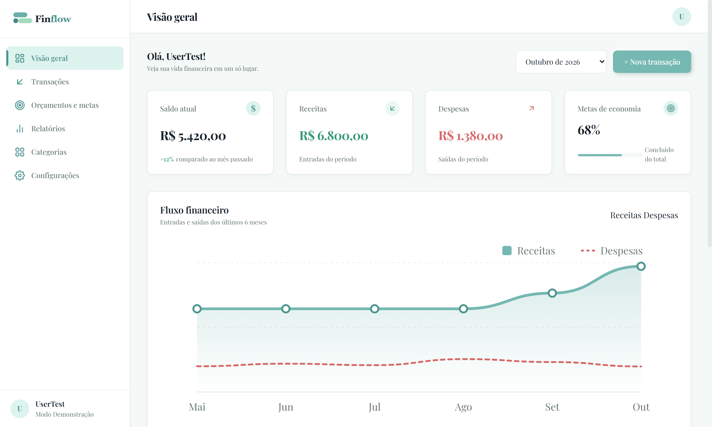
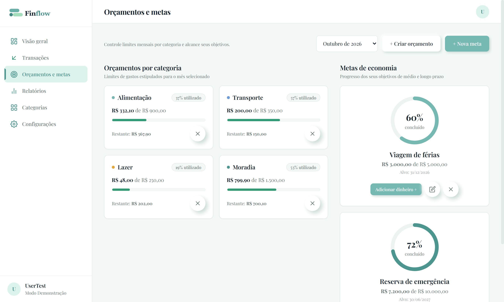
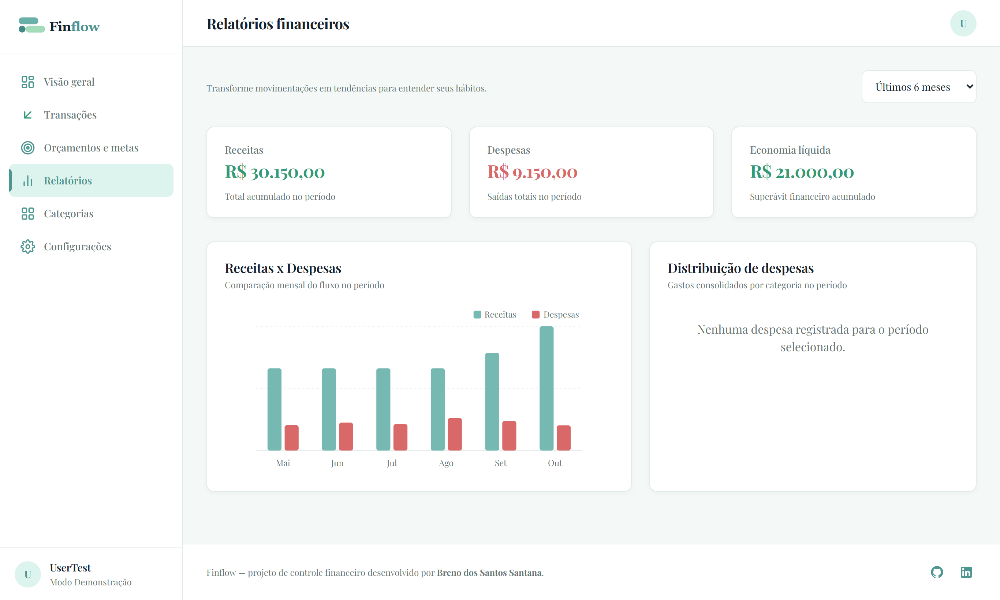
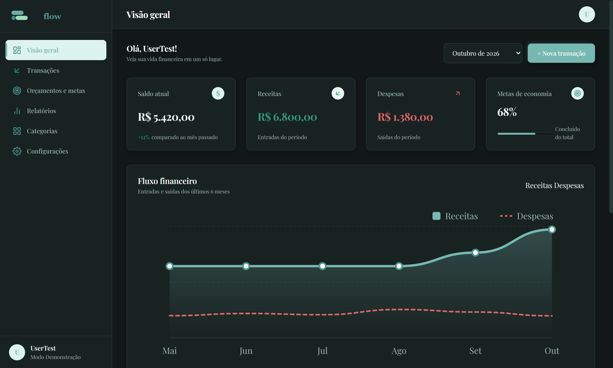
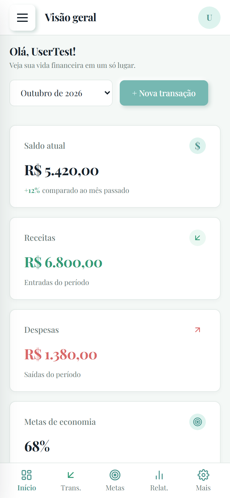

# Finflow — Seu Controle Financeiro

> Uma aplicação web moderna, leve e intuitiva de controle financeiro pessoal, desenvolvida com foco em engenharia de software front-end, design system consistente, acessibilidade e documentação técnica completa.

**Autor:** Breno dos Santos Santana  
**Objetivo:** Projeto de portfólio para demonstração prática de competências em desenvolvimento Front-end para oportunidades de estágio.  
**Demonstração Online:** Compatível com GitHub Pages (100% estático, sem necessidade de servidor backend).

---

## Demonstração Visual da Aplicação

<div align="center">
  
  <p><i>Painel executivo com métricas em tempo real, fluxo financeiro mensal em gráfico SVG suave e navegação rápida.</i></p>
</div>

### Galeria de Recursos e Experiência do Usuário

<div align="center">
  <br />
  <h4>Orçamentos por Categoria e Metas de Economia</h4>
  
  <p><i>Acompanhamento visual de tetos de gastos e metas com anéis de progresso circulares.</i></p>

  <br />
  <h4>Relatórios Analíticos e Tendências</h4>
  
  <p><i>Gráficos de barras mensais e consolidado financeiro desenvolvidos puramente com SVG vetorial.</i></p>

  <br />
  <h4>Tema Escuro (Dark Mode) e Adaptação Fluida para Celulares</h4>
  <div style="display: flex; justify-content: center; gap: 16px; flex-wrap: wrap;">
    
    
  </div>
  <p><i>Design responsivo com gaveta lateral retrátil no celular e alternância instantânea entre modo claro e escuro.</i></p>
</div>

---

## 1. Visão Geral e Proposta de Valor

O **Finflow** nasceu da necessidade de transformar a complexidade da gestão financeira diária em uma experiência visual acolhedora, clara e rápida. 

O projeto adota uma identidade visual original em tons de **verde-água (`#76B8B2`)**, **menta suave (`#DDF3EE`)** e **verde escuro (`#4D9690`)**, fundamentada em cartões brancos com bordas suaves, tipografia contemporânea e gráficos informativos nativos em SVG.

---

## 2. Funcionalidades Implementadas

- **Landing Page Institucional (Tela 01):** Apresentação do produto, prévia visual vetorial do painel, cartões de benefícios e chamada para ação com acesso instantâneo ao aplicativo.
- **Painel Executivo / Dashboard (Tela 03):** 
  - Cartões métricos com cálculo em tempo real de Saldo Atual, Receitas, Despesas e Metas ativas.
  - Gráfico nativo em SVG de fluxo financeiro com curvas suaves de receitas e despesas nos últimos 6 meses.
  - Listagem de transações recentes com data relativa ("Hoje", "Ontem", "12 out.") e valores formatados em moeda brasileira (`R$`).
  - Seletor dinâmico de período e botão de acesso rápido para novo lançamento.
- **Registro de Transações (Tela 05):** Modal acessível com alternância entre Receita e Despesa, validação em tempo real de campos obrigatórios, seleção dinâmica de categorias e campo de notas contextuais.
- **Lista Completa de Transações (Tela 04):**
  - Busca por texto em tempo real (descrição e nome da categoria).
  - Filtros multifatoriais por período (mês), tipo (receitas/despesas) e categoria.
  - Tabela com ações de edição e exclusão com diálogo de confirmação.
  - Paginação de dados e adaptação para cartões em celulares.
- **Orçamentos e Metas (Tela 06):**
  - Definição de tetos de gastos mensais por categoria com barras de utilização e alertas automáticos de atenção (>=80%) e limite excedido (>100%).
  - Metas de economia com anéis circulares percentuais (`goal-ring`), cálculo de valor restante e modal para registrar novos aportes/contribuições.
- **Relatórios Analíticos (Tela 07):** Gráfico comparativo de barras mensal em SVG (Receitas vs Despesas) e distribuição percentual proporcional de despesas por categoria.
- **Gestão de Categorias (Tela 08):** Cadastro, edição, escolha de paleta de cores e proteção de integridade referencial: impede a exclusão de categorias que possuem lançamentos ativos e oferece fluxo assistido de reclassificação.
- **Configurações e Gestão de Backup (Tela 09):** Preferências visuais (nome, moeda, chave toggle de tema claro/escuro), exportação de backup completo em `.json`, importação com validação de esquema, restauração de dados demo e limpeza total.
- **Login e Cadastro Demonstrativo (Tela 02):** Interface elegante com extração inteligente de nome pelo e-mail e aviso sobre o modo demonstração com LocalStorage.
- **Responsividade e Estados de Interface (Tela 10):** Menu lateral em gaveta retrátil (*off-canvas drawer*), barra de atalhos inferior em telas móveis (<768px), sistema de toasts acessíveis e ilustrações em estados vazios.

---

## 3. Tecnologias Utilizadas

- **HTML5 Semântico:** Estruturação orientada a acessibilidade (`<header>`, `<nav>`, `<main>`, `<aside>`, `<footer>`, `<dialog>`, `<table>`).
- **CSS3 Puro com Tokens de Design e Sistema Neumórfico:** Centralização de cores, tipografia, espaçamentos, relevo com sombras duplas e efeitos de interação tátil em `src/css/tokens.css`, sem dependência de Tailwind ou pré-processadores.
- **JavaScript Moderno (ES Modules Nativo):** Arquitetura desacoplada em módulos (`import`/`export`), sem ferramentas de empacotamento pesadas.
- **Recursos Gráficos Vetoriais (SVG):** Logotipo, ilustrações de hero, estados vazios e ícones desenvolvidos internamente em SVG.
- **LocalStorage API:** Persistência de dados segura com versionamento de esquema (`1.0.0`) e eventos customizados para reatividade.

---

## 4. Estrutura de Pastas do Projeto

```text
finflow/
├── index.html                   # Estrutura semântica completa e casca da SPA
├── README.md                    # Apresentação, telas e documentação geral do projeto
├── guide.md                     # Diretrizes permanentes de engenharia e sincronização
├── .gitignore                   # Arquivos ignorados no Git (ex.: changelog local)
│
├── docs/                        # Documentação técnica e de engenharia de software
│   ├── screenshots/             # Capturas de tela em alta resolução para visualização
│   │   ├── dashboard.png
│   │   ├── orcamentos.png
│   │   ├── relatorios.png
│   │   ├── dashboard-dark.png
│   │   └── mobile.png
│   ├── requisitos.md            # Especificação de requisitos funcionais e não funcionais
│   ├── arquitetura.md           # Arquitetura modular, responsabilidade de camadas e diagrama
│   ├── ux-ui.md                 # Guia de identidade visual, acessibilidade e padrões
│   ├── modelo-de-dados.md       # Diagrama de entidades, atributos e regras de integridade
│   ├── decisoes-tecnicas.md     # Registro de decisões arquiteturais (ADRs)
│   └── diagramas/               # Diagramas Mermaid (.mmd)
│       ├── arquitetura.mmd
│       ├── fluxo-de-navegacao.mmd
│       ├── modelo-de-dados.mmd
│       └── fluxo-de-dados.mmd
│
├── img/                         # Recursos visuais e gráficos vetoriais originais
│   ├── logo-finflow.svg
│   ├── simbolo-finflow.svg
│   ├── ilustracao-hero-finflow.svg
│   ├── ilustracao-sem-transacoes.svg
│   └── icones (svg)...
│
├── src/
│   ├── css/                     # Sistema de design modular em Vanilla CSS
│   │   ├── tokens.css           # Variáveis de cor, tipografia e espaçamento
│   │   ├── reset.css            # Normalização de estilo entre navegadores
│   │   ├── base.css             # Estilos fundamentais e acessibilidade (:focus-visible)
│   │   ├── layout.css           # Estrutura de casca (app-shell, sidebar e topbar)
│   │   ├── components.css       # Botões, cartões, formulários, modais, toasts e badges
│   │   ├── pages.css            # Estilos específicos de cada tela
│   │   └── responsive.css       # Regras para tablets e celulares (drawer e mobile-nav)
│   │
│   └── js/                      # Lógica da aplicação orientada a módulos ES
│       ├── app.js               # Inicialização geral e listeners
│       ├── router.js            # Roteador SPA baseado em Hash (#/)
│       ├── components/          # Componentes de interface (modal, toast, sidebar, empty-state)
│       ├── views/               # Controladores de tela (landing, dashboard, transactions, etc.)
│       ├── services/            # Camada de negócio e regras (transactions, budgets, goals, etc.)
│       ├── core/                # Camada de persistência LocalStorage com versionamento
│       └── utils/               # Funções de formatação BRL, cálculos de datas e validadores
│
└── tests/
    └── roteiro-de-testes.md     # Roteiro formal com 20 cenários de testes validados
```

---

## 5. Como Executar Localmente

Como o Finflow utiliza módulos nativos de JavaScript (`type="module"`), o navegador exige a execução sob um servidor web local simples (para respeitar as políticas de segurança de CORS de arquivos locais).

### Opção 1: Extensão Live Server do VS Code / Antigravity IDE
1. Abra a pasta do projeto no seu editor.
2. Clique com o botão direito no arquivo `index.html` e selecione **"Open with Live Server"**.
3. O navegador abrirá automaticamente em `http://127.0.0.1:5500/`.

### Opção 2: Python (Nativo no Linux, Mac e Windows)
Abra o terminal na pasta do projeto e execute:
```bash
python -m http.server 8000
```
Em seguida, acesse `http://localhost:8000` no seu navegador.

### Opção 3: Node.js / npx serve
```bash
npx serve .
```

---

## 6. Como Publicar no GitHub Pages

O projeto foi construído especificamente com caminhos relativos e roteador em Hash (`#/`) para funcionar 100% no GitHub Pages sem nenhuma dependência de backend:

1. No repositório no GitHub, clique na aba **Settings** (Configurações).
2. No menu lateral esquerdo, clique em **Pages**.
3. Em **Build and deployment**:
   - **Source:** Selecione `Deploy from a branch`.
   - **Branch:** Selecione `main` e a pasta `/ (root)`.
4. Clique em **Save**.
5. Em poucos instantes, o GitHub fornecerá a URL pública do seu Finflow (ex.: `https://breno2274.github.io/FinFlow/`).

---

## 7. Limitações Conhecidas da Versão Atual (MVP 1.0)

- **Persistência Local (LocalStorage):** Os dados ficam salvos exclusivamente no navegador do dispositivo utilizado. Não há sincronização entre múltiplos computadores ou celulares sem a exportação/importação manual do backup JSON.
- **Autenticação Online:** Não há autenticação remota em banco de dados no momento; a tela de login opera em modo pedagógico e demonstrativo, sem armazenar senhas no navegador.
- **Integração Bancária Automática:** Os lançamentos são inseridos manualmente pelo usuário ou através da carga de arquivos JSON.
- *Planejamento para a Fase 2:* Desacoplamento da camada `storage.js` para integração com Supabase ou Firebase via API REST.

---

## 8. Contato e Conexão Profissional

Projeto idealizado e desenvolvido por **Breno dos Santos Santana**:

- **LinkedIn:** [https://www.linkedin.com/in/breno-dos-santos-santana-2723a4213](https://www.linkedin.com/in/breno-dos-santos-santana-2723a4213)

---

*Finflow &copy; 2026 — Desenvolvido com carinho e precisão técnica para avaliação em vagas de estágio Front-end.*
