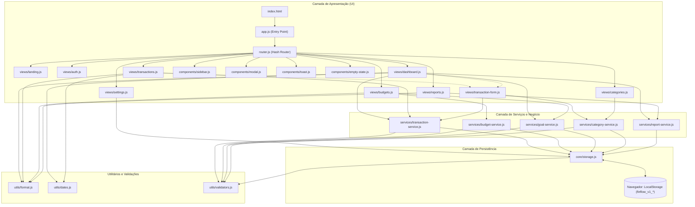

# Arquitetura do Sistema — Finflow

**Autor:** Breno dos Santos Santana  
**Projeto:** Finflow  
**Versão:** 1.0.0

---

## 1. Princípios Arquiteturais
O Finflow foi projetado com uma arquitetura **Single Page Application (SPA) nativa**, modular e desacoplada, utilizando exclusivamente recursos padronizados da Web (HTML5, CSS3, JavaScript ES Modules).

Os pilares fundamentais são:
1. **Zero Compiladores / Zero Dependências:** Não há Webpack, Vite, Babel ou React. O código é executado diretamente pelos navegadores modernos.
2. **Separação de Responsabilidades (SoC):** Cada módulo possui um escopo bem delimitado (armazenamento, regras de negócio, renderização de tela e utilitários).
3. **Reatividade Orientada a Eventos:** O `core/storage.js` dispara eventos globais (`finflow-data-changed`), permitindo que as views atualizem seus dados sem recarregar a página.
4. **Resiliência de Dados:** Versionamento de esquema (`1.0.0`) e validações estritas em tempo de execução para evitar corrupção do `LocalStorage`.

---

## 2. Visão Geral da Arquitetura

---

## 3. Divisão de Camadas e Módulos

### 3.1. Núcleo de Armazenamento (`src/js/core/storage.js`)
- Responsável pelo acesso de leitura e escrita ao `LocalStorage`.
- Previne dados corrompidos através de blocos `try/catch`.
- Realiza a carga inicial dos dados de demonstração caso o usuário acesse a aplicação pela primeira vez.
- Provê mecanismos de exportação e importação de backups no formato JSON.

### 3.2. Camada de Serviços (`src/js/services/`)
- **`transaction-service.js`:** Executa criação, atualização, exclusão, filtragem multifatorial (texto, tipo, categoria, data), ordenação, paginação e consolidação de receitas e despesas.
- **`budget-service.js`:** Avalia o consumo dos limites estipulados confrontando as despesas reais do mês com os tetos cadastrados, categorizando os status em `normal`, `warning` e `exceeded`.
- **`goal-service.js`:** Controla metas financeiras, aportes incrementais e percentuais de conclusão.
- **`category-service.js`:** Valida unicidade de categorias e garante integridade referencial, impedindo remoção de categorias que contenham movimentações ativas.
- **`report-service.js`:** Agrega dados históricos para gráficos e distribuições percentuais de despesas.

### 3.3. Roteamento e Apresentação (`src/js/router.js`, `src/js/views/` e `index.html`)
- **Arquitetura Declarativa (Semantic HTML-First):** Todo o esqueleto da aplicação, títulos (`<h1>`, `<h2>`), parágrafos descritivos, seções semânticas (`<section>`), barra lateral e formulários estão declarados diretamente no arquivo raiz `index.html`.
- **Roteador SPA por Classes:** O roteador baseado em hash (`router.js`) controla a visibilidade das telas chaveando classes `.active` nos nós `.view-screen` (telas públicas) e `.subpage-view` (dentro de `#view-app-shell`), evitando a destruição e recriação do DOM e facilitando a edição de textos no HTML.
- **Views Reativas:** Os controladores em `src/js/views/` atuam atualizando exclusivamente os contêineres dinâmicos de dados (tabelas, contadores de saldo, gráficos em SVG e badges) e escutando eventos de interação do usuário.

### 3.4. Componentes Compartilhados (`src/js/components/`)
- **`modal.js`:** Gerenciamento de caixas de diálogo acessíveis com armadilha de foco, fechamento por tecla `Escape` e suporte a diálogos de confirmação de ações de perigo.
- **`toast.js`:** Notificações não intrusivas com cores semânticas e suporte a leitores de tela (`aria-live="polite"`).
- **`sidebar.js`:** Menu de navegação lateral para desktop e gaveta retrátil com overlay para celulares.
- **`empty-state.js`:** Ilustrações acolhedoras quando listas não contêm itens.
