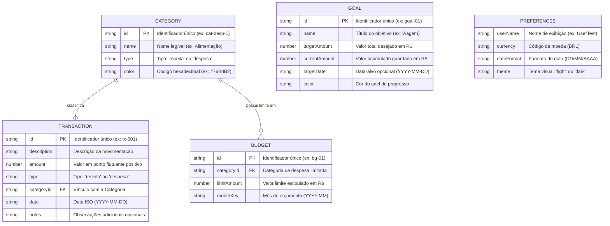

# Modelo de Dados — Finflow

**Autor:** Breno dos Santos Santana  
**Projeto:** Finflow  
**Versão do Esquema:** 1.0.0

---

## 1. Visão Geral do Modelo
Na primeira versão estática do Finflow, os dados são persistidos no navegador do usuário utilizando o `LocalStorage`. Para garantir robustez e permitir futura migração para um backend relacional (como PostgreSQL/Supabase), as entidades foram estruturadas com identificadores únicos (*PK*), chaves estrangeiras lógicas (*FK*) e regras de integridade.

---

## 2. Diagrama Entidade-Relacionamento (ERD)



---

## 3. Detalhamento dos Atributos das Entidades

### 3.1. Entidade: Transação (`Transaction`)
Representa cada entrada (receita) ou saída (despesa) financeira registrada pelo usuário.

| Atributo | Tipo de Dado | Obrigatório | Descrição / Exemplo |
|---|---|---|---|
| `id` | `String` | Sim | Identificador único (`tx-1729440000000-a1b2`). |
| `description` | `String` | Sim | Descrição do lançamento (mínimo de 2 caracteres). Ex: "Supermercado". |
| `amount` | `Number` | Sim | Valor monetário em ponto flutuante, estritamente positivo (> 0). Ex: `185.40`. |
| `type` | `String` | Sim | Tipo de fluxo: `'receita'` ou `'despesa'`. |
| `categoryId` | `String` | Sim | Chave estrangeira que referencia uma categoria existente. |
| `date` | `String` | Sim | Data da movimentação no padrão ISO `YYYY-MM-DD`. Ex: `"2026-10-14"`. |
| `notes` | `String` | Não | Anotações adicionais e observações contextuais. |

### 3.2. Entidade: Categoria (`Category`)
Classificação temática de receitas e despesas.

| Atributo | Tipo de Dado | Obrigatório | Descrição / Exemplo |
|---|---|---|---|
| `id` | `String` | Sim | Identificador único. Ex: `"cat-rec-1"`, `"cat-desp-2"`. |
| `name` | `String` | Sim | Nome da categoria (único por tipo). Ex: `"Alimentação"`. |
| `type` | `String` | Sim | Aplicação: `'receita'` ou `'despesa'`. |
| `color` | `String` | Sim | Código hexadecimal da cor de apoio. Ex: `"#76B8B2"`. |

### 3.3. Entidade: Orçamento (`Budget`)
Define o teto de gastos mensais atribuído a uma categoria de despesa.

| Atributo | Tipo de Dado | Obrigatório | Descrição / Exemplo |
|---|---|---|---|
| `id` | `String` | Sim | Identificador único (`bg-01`). |
| `categoryId` | `String` | Sim | Chave estrangeira referenciando a categoria de despesa. |
| `limitAmount` | `Number` | Sim | Valor máximo planejado para gastos (> 0). Ex: `900.00`. |
| `monthKey` | `String` | Sim | Mês de vigência no formato `YYYY-MM`. Ex: `"2026-10"`. |

### 3.4. Entidade: Meta de Economia (`Goal`)
Objetivo financeiro de médio e longo prazo.

| Atributo | Tipo de Dado | Obrigatório | Descrição / Exemplo |
|---|---|---|---|
| `id` | `String` | Sim | Identificador único (`goal-01`). |
| `name` | `String` | Sim | Nome do objetivo. Ex: `"Viagem de férias"`. |
| `targetAmount` | `Number` | Sim | Valor total a ser alcançado (> 0). Ex: `5000.00`. |
| `currentAmount` | `Number` | Sim | Valor já guardado/economizado (>= 0). Ex: `3000.00`. |
| `targetDate` | `String` | Não | Data prevista para alcançar o objetivo (`YYYY-MM-DD`). |
| `color` | `String` | Não | Cor de preenchimento do anel circular. |

---

## 4. Chaves e Estrutura no LocalStorage
Para evitar colisões com outras aplicações no mesmo domínio, todas as chaves são prefixadas:

```javascript
const STORAGE_PREFIX = 'finflow_v1_';

const KEYS = {
  SCHEMA: 'finflow_v1_schema',
  TRANSACTIONS: 'finflow_v1_transactions',
  CATEGORIES: 'finflow_v1_categories',
  BUDGETS: 'finflow_v1_budgets',
  GOALS: 'finflow_v1_goals',
  PREFERENCES: 'finflow_v1_preferences'
};
```

---

## 5. Regras de Integridade e Proteção de Dados Órfãos
1. **Validação de Número:** Valores são armazenados internamente como `Number` em ponto flutuante e nunca como strings formatadas com símbolos (`"R$ 150,00"`). A formatação monetária ocorre estritamente na camada de apresentação.
2. **Exclusão Segura de Categoria:** O `category-service.js` verifica se existem transações vinculadas à categoria antes de permitir a exclusão. Caso existam, o sistema obriga o usuário a reclassificar os lançamentos para uma nova categoria ativa.
3. **Validação Estrutural de Backup:** Ao importar um backup JSON, todos os nós de dados são validados (`validateBackupJSON`), garantindo que o esquema e os tipos coincidam antes de qualquer escrita no armazenamento.
